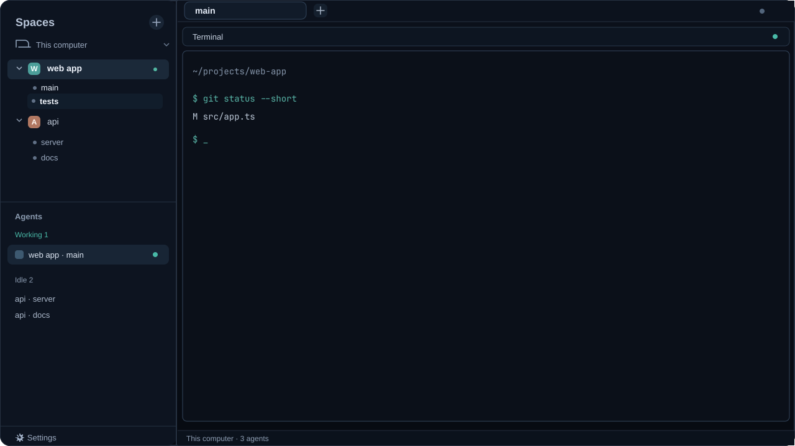

# Herdr: Tabs Under Spaces

A shareable Herdr layout that displays each space's tabs as an indented list beneath the space name. Lists are expanded by default and can be collapsed per space. The active tab is white text with no selected-row fill. The layout removes the brand banner so the Spaces heading sits at the top of the sidebar.



## Install

```sh
git clone https://github.com/hotdoggity/herdr-spaces-tabs.git
cd herdr-spaces-tabs
./install.sh
```

The installer backs up conflicting layout/mod files before replacing them,
checks each custom mod, and switches to `main-tabs` if Herdr is running.
Otherwise, open Herdr and run `herdr-app do layout.switch '{"name":"main-tabs"}'`.
The package includes compact clones of the stock `agents`, `pane`, `tabs`,
`workspace-chrome`, and `workspace-status` mods plus `spaces-with-tabs`. It
also uses the stock `changes`, `files`, and `menu` mods.

See [`RECIPE.md`](RECIPE.md) for the layout details and checks.

## Access and license

The `spaces-with-tabs` mod adapts Herdr's shipped Spaces mod and retains its
repository and machine behavior: it runs `git status` and `git rev-parse` in
folders shown by spaces, watches local repository folders, and calls
`hc machine ls`. Its explicit Connect action for a rebuilt machine can call
`hc machine rm` and `hc machine add`. It does not fetch or send repository
content itself. The other compact mods only reduce spacing in shipped views.
Review the mod before installing if you don't want those behaviors.

The layout and adapted mod are distributed under Apache-2.0; see [LICENSE](LICENSE).
