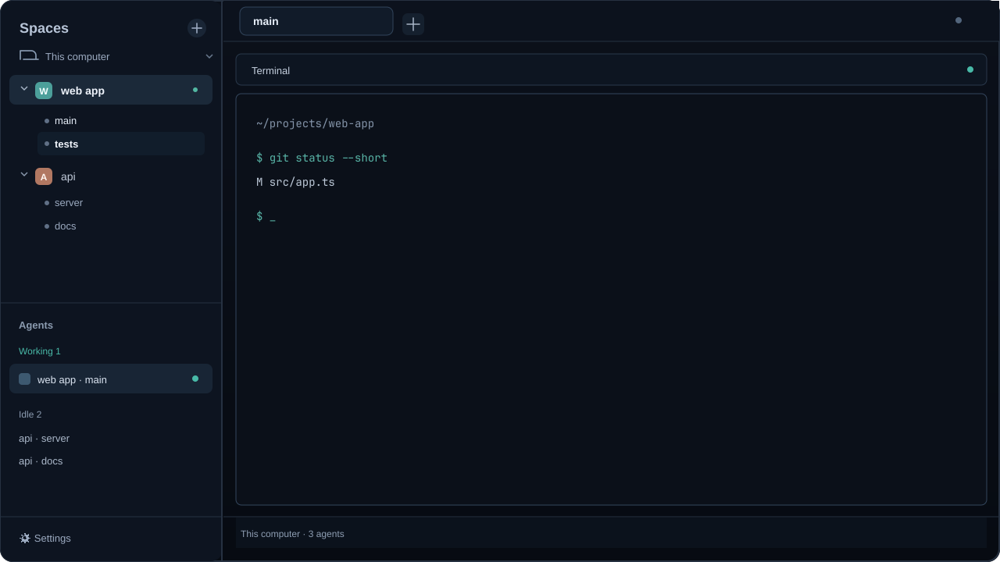

# Tabs Under Spaces

The sidebar starts with **Spaces** and no brand banner. Each space has an expanded-by-default, indented tab list; its chevron folds that list, and the active tab is identified by white text rather than a selected-row fill. The Agents list remains below. The illustration uses generic space and tab names.

## What you see

- **Left sidebar (268 px):** Spaces above Agents, with a 69 px footer. Space rows keep colored avatars and machine grouping. The Spaces section has no Herdr logo/header block above it.
- **Tab rows:** each is 25 px high, indented 37 px from the list edge. The active name uses the theme foreground; inactive names use muted text. Status dots use the theme's `working`, `blocked`, `done`, or `idle` color when the tab has that status. No selected-row fill is used; hover uses the theme's `hover` color.
- **Main area:** 42 px tab bar, active tab with its pane header, and 28 px status bar. The optional 368 px Files/Changes panel starts hidden.
- Colors follow Herdr's current theme (`chrome`, `canvas`, `background`, `border`, `accent`, and status colors).

## How it behaves

- Tab lists start expanded. A right/down chevron beside each space name collapses/reveals its tabs. Each space's collapsed state persists in the `spaces-with-tabs` mod's local storage.
- Clicking a tab row runs `tab.select`; clicking a space selects it. Right-clicking a space opens its normal space menu. Space rows can be dragged to reorder; recognized worktrees are listed under their main checkout.
- The normal compact sidebar rail is used below 160 px. It lists numbered spaces and hides tab rows.
- The Agents panel preserves the stock status behavior: working uses a spinner; blocked is a “Needs you” warning; done uses a filled status dot; idle uses a ring. Agent rows focus their terminal; rows can show subagents and their statuses.
- Machine sections can fold, add a space, and report connection state. The explicit Connect action handles a rebuilt machine.

## Built from

- `layouts/main-tabs.json`: root row with a sidebar column and a work column. The sidebar contains a vertical Spaces/Agents split and footer. The work column contains the tab bar, active tab/pane, hidden Files/Changes stack, and status bar. `layouts/main-tabs.png` is the settings preview.
- `mods/spaces-with-tabs/main.js`: clone of Herdr's shipped `spaces` mod with an extra row for each tab, per-space expand/collapse, and `tab.select` on tab-row click. `mod.json` names the panel. It uses `spaces()`, `machines()`, `panes()`, `layout()`, `theme()`, `shared()`/`setShared()`, `watchFolder()`, `exec()`, `hc()`, `openOverlay()`, and `run()`.
- The custom mod calls `tab.select`, `space.select`, `space.move`, and `space.new`. It also uses the shipped `menu` for the space context menu and shipped `workspace-chrome` SVG assets. The layout uses Herdr's shipped `agents`, `changes`, `files`, `menu`, `pane`, `tabs`, `workspace-chrome`, and `workspace-status` mods.

## Watch out

- The list can become tall when a space has many tabs; the sidebar scrolls. Collapse a space to save room.
- Below 160 px sidebar width, the compact rail intentionally hides tab names.
- The mod retains upstream repository/machine behavior: it runs `git status` and `git rev-parse` in each space's current folder, watches local repository folders, and calls `hc machine ls`. Choosing Connect for a rebuilt machine can call `hc machine rm` and `hc machine add`. It does not fetch or send repository content.
- The layout expects the listed shipped Herdr mods to be installed. It does not bundle or replace them.

## Done when

1. `herdr-app check ~/.config/herdr-app/mods/spaces-with-tabs` passes.
2. `herdr-app do layout.switch '{"name":"main-tabs"}'` opens the layout without errors.
3. Tabs appear under each space; their chevrons collapse and reopen the list; clicking one selects it.
4. In Herdr's compact rail, tab rows disappear while the space list remains usable.
